<div align="center">

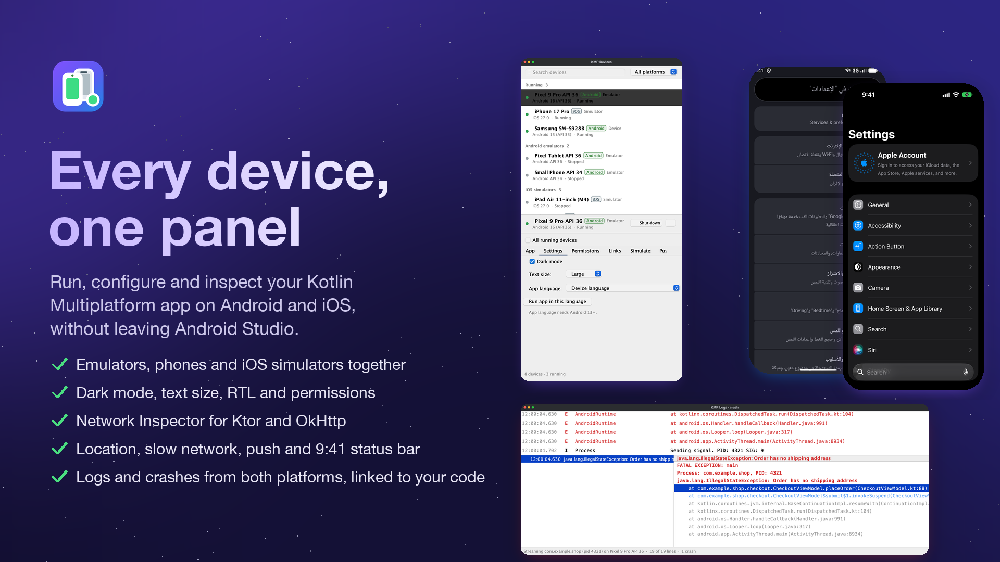

# KMP Device Hub

**Every Android device, emulator and iOS simulator in one panel.**

For Kotlin Multiplatform and Compose Multiplatform developers who test on Android and iOS every day.

[](https://plugins.jetbrains.com/plugin/35272-kmp-device-hub)
[](https://plugins.jetbrains.com/plugin/35272-kmp-device-hub)
[](https://plugins.jetbrains.com/plugin/35272-kmp-device-hub/reviews)
[](https://central.sonatype.com/artifact/io.github.khubaibkhan4/devicehub-network)


[](https://ko-fi.com/Y8Y2YABZ7)
[](https://www.buymeacoffee.com/khubaibkhan)

[▶ Watch the 1-minute preview](docs/kmp-device-hub-preview.mp4)

</div>

## Install

In Android Studio or IntelliJ IDEA (2025.1 or newer): **Settings → Plugins → Marketplace**, search for
**KMP Device Hub**, install, and restart. Or install it from its
[JetBrains Marketplace page](https://plugins.jetbrains.com/plugin/35272-kmp-device-hub). Then open the **KMP Devices** tool window (right) and **KMP Network**
(bottom).

You need the Android SDK for Android devices, and macOS with Xcode for iOS simulators. Both are found automatically,
including the project's `sdk.dir`.

## Features

### Every device, one panel

Running and stopped Android emulators, connected phones (USB or Wi-Fi) and iOS simulators in one list, with search and
a platform filter. Start or shut down any of them, and launch, stop, clear or uninstall your app; its Android
`applicationId` and iOS bundle id are found in your project.

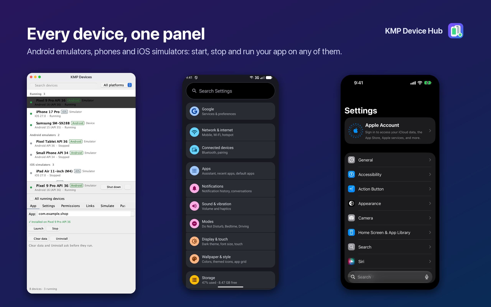

### Dark mode, text size and right-to-left

Switch appearance and text size on Android and iOS, and run your app in another language, including Arabic, Urdu and
Hebrew for right-to-left layouts. The app restarts in the new language on both platforms. With
[KMP Translations Hub](https://plugins.jetbrains.com/plugin/35376-kmp-translations-hub) installed, **Run App in Selected
Locale** in its Translations table does the same for the language of the column you're in.

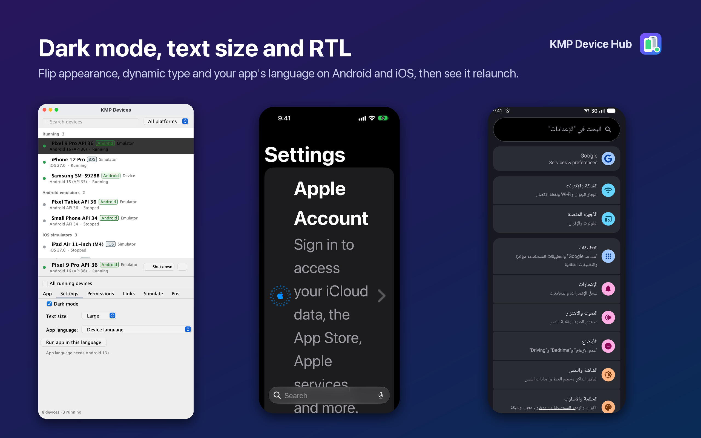

### Permissions

See what your app was granted, then grant, revoke or reset permissions (camera, location, microphone, contacts, photos,
calendar, notifications) without digging through Settings.

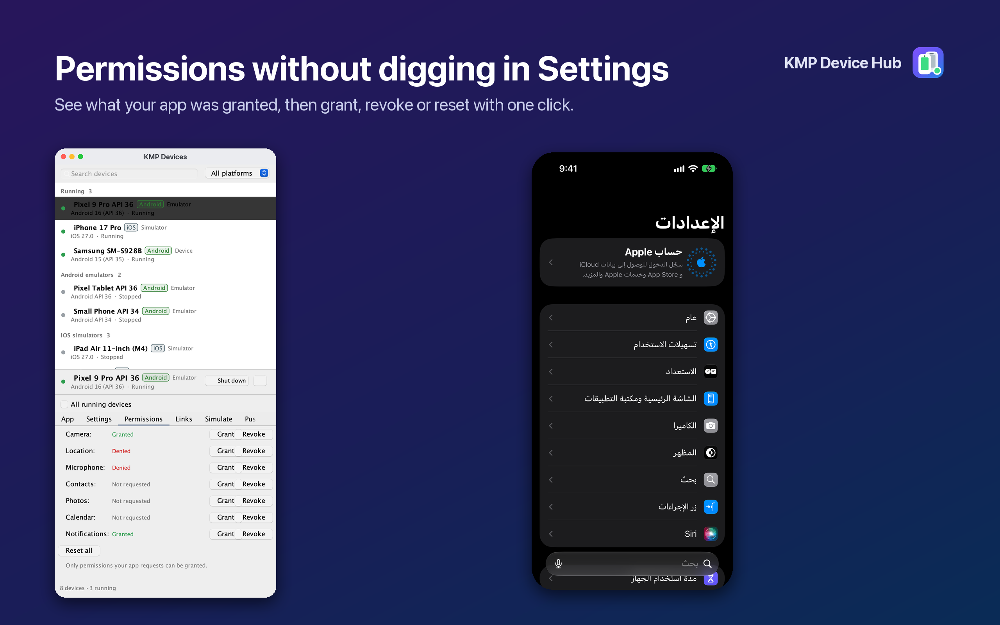

### Network Inspector

Every HTTP call your app makes, Ktor on Android, iOS and JVM or OkHttp/Retrofit on Android: status, timing, size,
headers, pretty-printed bodies and a JSON tree, plus totals, throughput and device connectivity. Copy any call as cURL.
[Set it up](#network-inspector-setup) with one line in your `HttpClient`.

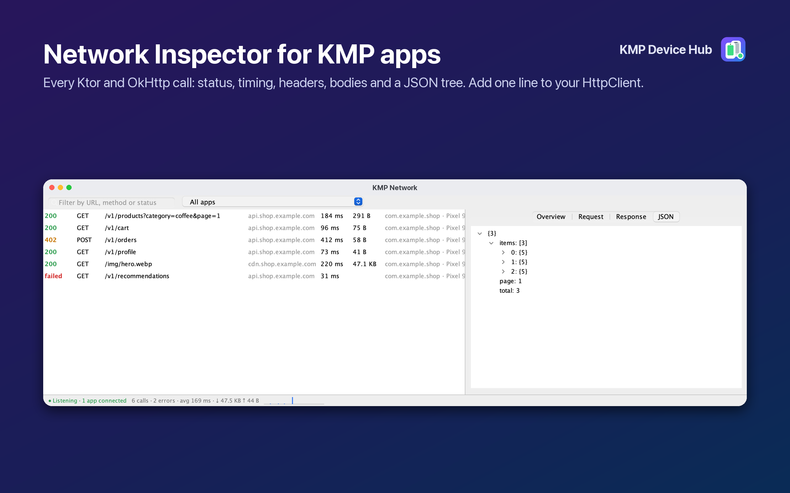

Errors stand out: 4xx/5xx responses and failed calls (no connection, unknown host, timeouts). Mock responses, fail
requests or add latency to test your error states, and export everything as HAR.

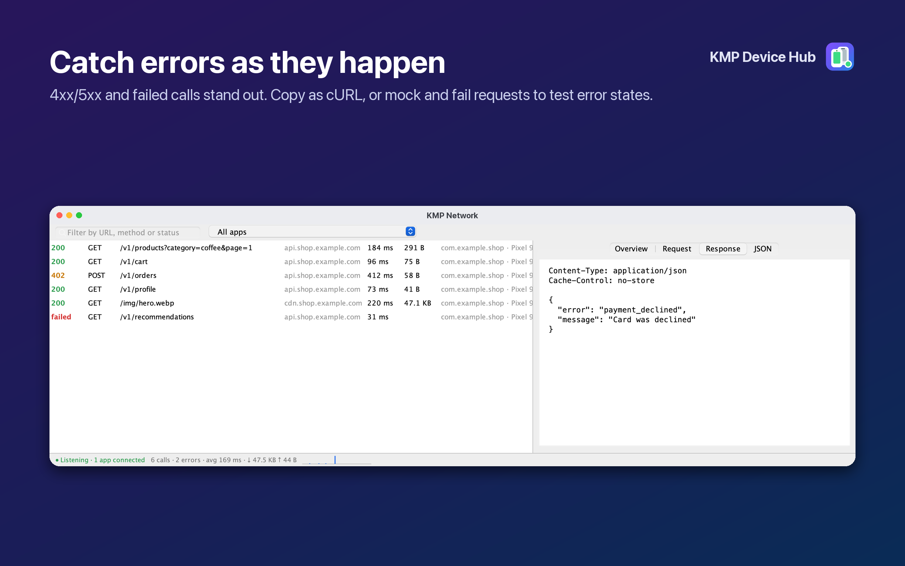

### Logs from both platforms

The **KMP Logs** window streams your app's logs: Android's logcat filtered to your app (it follows restarts), and on iOS
simulators the unified log for your app, or its stdout so Kotlin/Native `println` shows up too. Filter by level, search,
copy or export what you see.

When your app crashes (an Android fatal exception, an uncaught Kotlin/Native exception, an Objective-C exception or a
Swift fatal error), the crash appears under the log with its stack trace. Lines in your own code are links to the
source, and the first of them is already selected; double-click a stack trace line in the log to open it too. If KMP
Logs is hidden when your app crashes, a notification tells you.

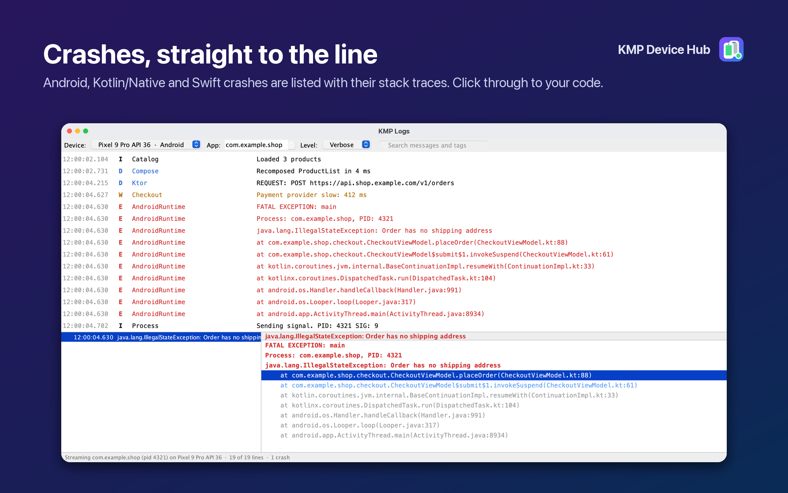

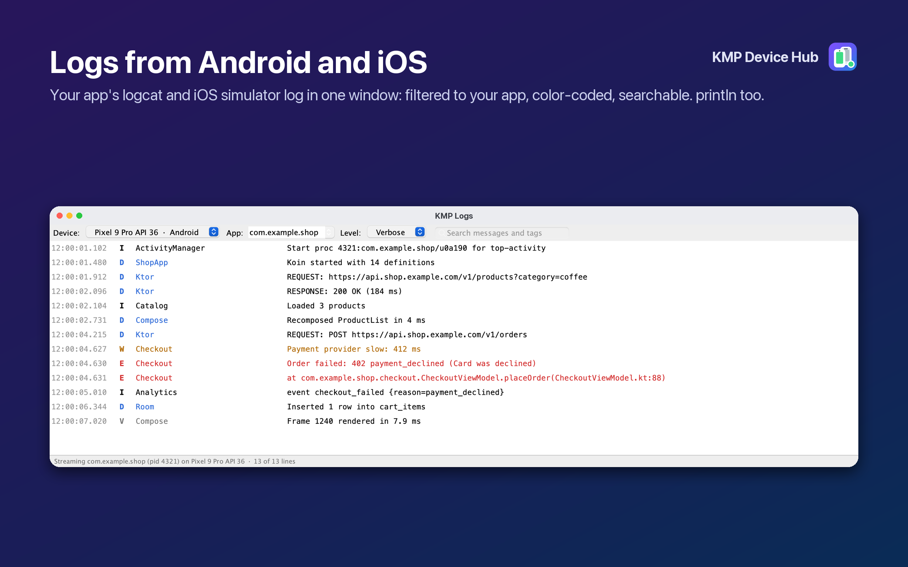

### App data explorer

The **KMP App Data** window opens your app's private data: files on Android (debug builds, through `run-as`, like
Android Studio's Device Explorer) and in iOS simulator containers; SharedPreferences and NSUserDefaults as key / type /
value tables; and SQLite databases (Room, SQLDelight, Core Data) with a table view and read-only SQL on a snapshot that
includes the WAL. Text and JSON are pretty-printed, images previewed, and files can be downloaded or deleted.

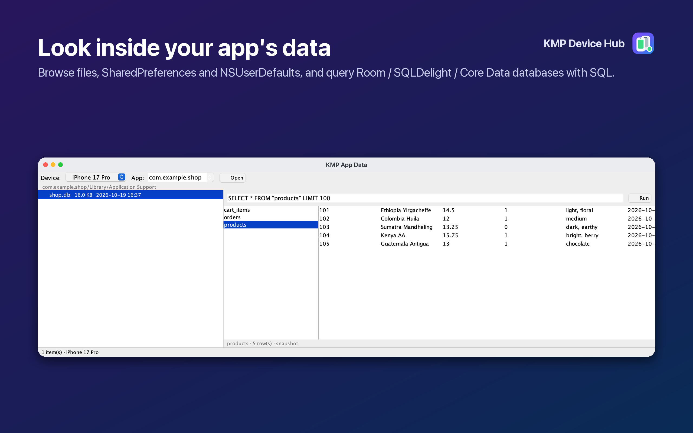

### Install builds

Drop an `.apk` (or split APKs) or a simulator `.app` on any device in the list, or use **Install App…**, which opens at
your project's latest build. Common failures (signature mismatch, missing ABI, App Bundle instead of APK, device build
instead of simulator build) are explained in plain words.

### Simulate the real world

Simulated location, Android emulator network conditions (LTE, 3G, EDGE, GPRS or offline), battery level and charging,
screen rotation, Face ID / Touch ID / fingerprint that matches or fails, photos and videos added to the gallery,
clipboard text, push notifications (a real push on iOS, a notification-tap intent on Android), deep links,
screenshots, screen recording and a clean 9:41 status bar for store screenshots.

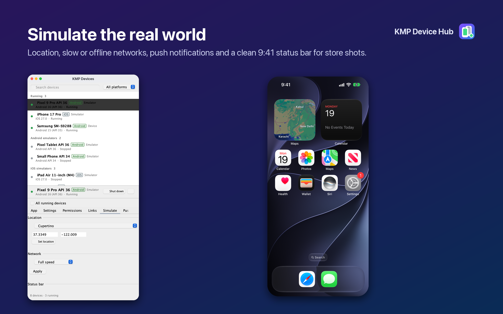

### Test presets

Set several conditions at once: dark mode with the largest text, right-to-left, long German words, a slow or offline
network, store screenshots, or your own. Turn on **All running devices** to apply anything to every device at once.

**Capture store screenshots** relaunches your app in each language you pick (and dark mode) with a clean 9:41 status
bar on every running device, and saves `<language>-light.png` / `-dark.png` in a folder per device.

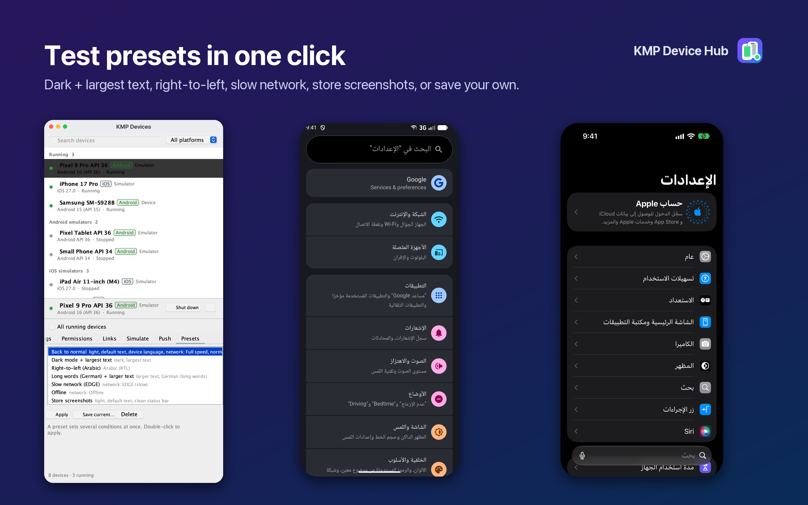

## Network Inspector setup

Add the library to your app's debug builds, then install it in your HTTP client:

```kotlin
// build.gradle.kts — commonMain (or debugImplementation in an Android-only app)
implementation("io.github.khubaibkhan4:devicehub-network:0.1.0")

// Ktor (Android, iOS, JVM)
val client = HttpClient {
    install(DeviceHubNetwork) { enabled = isDebugBuild }
}

// OkHttp / Retrofit (Android)
OkHttpClient.Builder().addInterceptor(DeviceHubInterceptor { enabled = BuildConfig.DEBUG })
```

The library connects to the IDE on `127.0.0.1:38383`. iOS simulators reach it directly, and Android devices and
emulators reach it through `adb reverse`, which the plugin sets up. Bodies over 128 KB and binary content are reported
by size only. Use `redactHeaders = setOf("Authorization")` to keep secrets out of the IDE.

**Only enable it in debug builds**: it sends your app's traffic, headers included, to whatever listens on that port.

For release builds, depend on `io.github.khubaibkhan4:devicehub-network-noop` instead: the same API, doing nothing,
so your code compiles unchanged and no traffic ever leaves a release build. In an Android-only app:

```kotlin
debugImplementation("io.github.khubaibkhan4:devicehub-network:0.1.0")
releaseImplementation("io.github.khubaibkhan4:devicehub-network-noop:0.1.0")
```

It's on Maven Central (`mavenCentral()`), so no extra repository is needed. To try local changes, publish with
`./gradlew :network:publishToMavenLocal` and add `mavenLocal()`.

## Free and Pro

Everything is free during early access. Later, a Pro plan through JetBrains Marketplace (with a free trial) will cover
the power features: all-devices actions, presets, screen recording, the push tester, the deep link library, location,
network conditions, battery, rotation, biometrics, media, the clean status bar and store screenshots, and the Network Inspector's mocking
and HAR export. Device control, installing builds, settings, permissions, logs, the app data explorer and the Network
Inspector itself stay free.

If it saves you time, you can support its development on [Ko-fi](https://ko-fi.com/Y8Y2YABZ7) or [Buy Me a Coffee](https://www.buymeacoffee.com/khubaibkhan). A rating
or review on the [Marketplace page](https://plugins.jetbrains.com/plugin/35272-kmp-device-hub/reviews) helps a lot too.

## Roadmap

- App data: edit preferences and DataStore files in place
- Physical iPhones (install, logs, screenshots)

## How it works

| Module | What it is |
|---|---|
| [`core`](core) | Dependency-free engine: finds `adb`, `emulator` and `xcrun`, lists devices, and runs every device action, setting, simulation and preset through them. Every command goes through a `CommandRunner`, faked in tests. |
| [`network`](network) | `devicehub-network`, the Kotlin Multiplatform library (JVM/Android, iOS) apps add to send their HTTP calls to the Network Inspector: a Ktor client plugin and an OkHttp interceptor. |
| [`idea-plugin`](idea-plugin) | The KMP Devices, KMP Network, KMP Logs and KMP App Data tool windows for Android Studio and IntelliJ IDEA 2025.1+. |
| [`samples/network-demo`](samples/network-demo) | A small Android + iOS app for trying the Network Inspector. |

## Development

```bash
echo 'devicehub.ideaLocalPath=/Applications/Android Studio.app' >> local.properties   # git-ignored
export JAVA_HOME="/Applications/Android Studio.app/Contents/jbr/Contents/Home"
./gradlew build                 # all tests
./gradlew :idea-plugin:runIde   # sandbox IDE with the plugin
```

Releasing (plugin, Maven Central, listing screenshots and video) is described in [RELEASE.md](RELEASE.md) and
[tools/listing](tools/listing/README.md).

© 2026 Khubaib Khan. All rights reserved.
